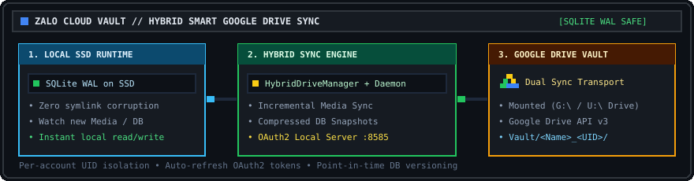
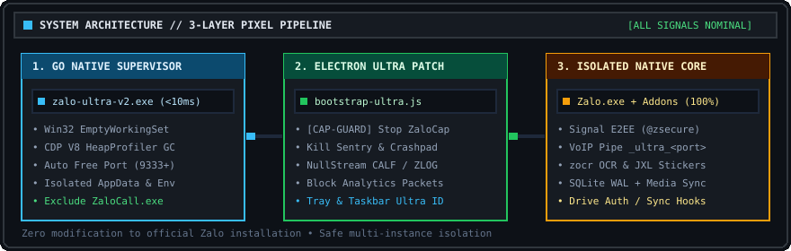

<div align="center">



<br />

[](#)
[](#)
[](#)
[](#)
[](#-đồng-bộ-google-drive--zalo-cloud-vault)
[](#)

**Zalo PC siêu nhẹ RAM, chạy song song nhiều tài khoản không xung đột, giữ 100% tính năng gốc.**

[⬇️ Tải Ngay (1-Click)](#-tải-về--dùng-ngay-1-click--không-cần-biết-code) • [Tính năng](#-danh-sách-tính-năng-đầy-đủ) • [Đồng bộ Google Drive](#-đồng-bộ-google-drive--zalo-cloud-vault) • [Kiến trúc](#-kiến-trúc-3-lớp) • [Đo hiệu năng thực tế](#-đo-hiệu-năng-thực-tế-zalo-gốc-vs-zalo-ultra) • [Build từ Source](#-hướng-dẫn-cài-đặt--sử-dụng)

</div>

---

## ⬇️ Tải Về & Dùng Ngay (1-Click — Không Cần Biết Code)

> **Yêu cầu duy nhất:** Máy Windows 64-bit đã cài sẵn Zalo PC bản chính thức ([tải tại zalo.me/pc](https://zalo.me/pc)). Bản Ultra chạy tách biệt hoàn toàn, không làm hỏng dữ liệu Zalo gốc.

| Phiên bản tải về | Dành cho ai | Tải trực tiếp |
| :--- | :--- | :--- |
| **`ZaloUltraClient-v2.0.0-win64.exe`** | Tải 1 file duy nhất, bấm đúp chạy ngay lập tức | [](https://github.com/xomno01/zalo-ultra-client/releases/latest/download/ZaloUltraClient-v2.0.0-win64.exe) |
| **`ZaloUltraClient-v2.0.0-win64-portable.zip`** | Bản Portable kèm nút `Tao_Icon_Desktop.bat` & hướng dẫn tiếng Việt | [](https://github.com/xomno01/zalo-ultra-client/releases/latest/download/ZaloUltraClient-v2.0.0-win64-portable.zip) |
| **Tất cả phiên bản (Releases)** | Xem changelog & mã kiểm tra SHA-256 | [](https://github.com/xomno01/zalo-ultra-client/releases/latest) |

- **Cách dùng siêu đơn giản:**
  1. Tải bản **`.exe`** (hoặc tải **`.zip`** rồi giải nén ra một thư mục cố định như `D:\ZaloUltraClient`).
  2. Bấm đúp vào **`ZaloUltraClient.exe`** để mở ngay. *(Bản `.zip` có sẵn file **`Tao_Icon_Desktop.bat`** — bấm 1 cái là tạo icon ngoài màn hình chính).*
  3. Nếu Windows SmartScreen hiện *"Windows protected your PC"* (do file Go mã nguồn mở chưa mua chữ ký số thương mại): bấm **More info** → **Run anyway**.

---

## ✨ Danh Sách Tính Năng Đầy Đủ

Zalo Ultra không viết lại app giả mạo (tránh bị khóa tài khoản bởi Signal E2EE / protocol VNG), mà dùng **Native Go Supervisor** kết hợp **Runtime Patch** để bóc sạch bloatware và kiểm soát bộ nhớ trên chính nhân Zalo PC.

### 1. Tối ưu & Nén RAM chủ động (Active RAM Compactor)
- **Win32 Working Set Trimming:** Gọi trực tiếp `EmptyWorkingSet` định kỳ trên toàn bộ cây tiến trình `Zalo.exe` để giải phóng trang nhớ vật lý nhàn rỗi.
- **CDP V8 Garbage Collection:** Kết nối tới Remote Debugging Port (`127.0.0.1:9333+`) qua WebSocket RFC 6455 tự viết để phát lệnh `HeapProfiler.collectGarbage` và `window.gc()` tới toàn bộ renderer/webview.
- **Cân bằng V8 Heap & Cache:** Giới hạn heap JavaScript ở mức cân bằng (`--expose-gc --max-old-space-size=320`, bỏ `--optimize-for-size` để tránh re-JIT/GC liên tục), khóa Disk Cache & Media Cache tối đa `32 MB` mỗi loại (`33554432` bytes).
- **Chu kỳ nén thông minh (`--compact-interval`):** Mặc định `120s` (tối thiểu `15s`), kiểm tra mỗi `10s`: chỉ nén khi thu nhỏ cửa sổ (`30s`), khi máy idle >= `30s` (`compactSeconds`), chạy nền (`compactSeconds`), và nén nhẹ khi đang dùng trực tiếp (`3 × compactSeconds` = `360s`) để không gây khựng hay tăng CPU khi chat.
- **Bảo vệ luồng gọi VoIP:** Tự động loại trừ `ZaloCall.exe` khỏi danh sách `EmptyWorkingSet` để giữ nguyên buffer âm thanh/RTP, đảm bảo đổ chuông tức thì không bị khựng.

### 2. Triệt tiêu Telemetry & Spam ghi ổ đĩa (Zero Disk Wear)
- **Vô hiệu hóa hoàn toàn Sentry & Crashpad:** Mock toàn bộ `crashReporter` API của Electron, `sentry.js` trong `require.cache`, và chặn các module `@sentry/*` qua `Module.prototype.require`.
- **Chặn gói tin theo dõi mạng:** Dùng `session.webRequest.onBeforeRequest` hủy mọi request tới `*.sentrypc.api.zalo.me`, `*.senpc.api.zalo.me`, `*.google-analytics.com`, `*.doubleclick.net`.
- **Triệt tiêu CALF Brotli & Log rác:** Tắt `nativeLogger.setOffLog(true)` và chuyển hướng `fs.createWriteStream`, `fs.writeFile*`, `fs.appendFile*` cho các file `.calf`, `.zlog`, `DNetLog*.log`, `cloud-*.log`, `scrshot/voip/call/startup/update.log` vào `NullWritableStream` (0 Disk I/O, 0 CPU nén Brotli), trong khi vẫn giữ nguyên toàn bộ file `.db`, `.db-wal`, `.json`.

### 3. Chạy song song nhiều tài khoản & Gọi điện không xung đột
- **Cô lập Profile & Môi trường 100%:** Launcher tự gán `USERPROFILE`, `APPDATA`, `LOCALAPPDATA` và `--user-data-dir` riêng cho từng `--profile` hoặc `--data-dir`, không đụng lock GPU/SQLite với Zalo gốc.
- **Tách Named Pipe VoIP động (`ZALO_PIPE_SUFFIX`):** Tự động cấp hậu tố riêng theo từng cổng instance (`_ultra_<actualPort>`, ví dụ `_ultra_9333`, `_ultra_9334`...), tránh lỗi `EADDRINUSE` trên `\\.\pipe\PipeZCallRecv` và `PipeZCallSend` khi mở nhiều bản Zalo Ultra hoặc chạy kèm Zalo gốc.
- **Auto-Fallback Remote Debugging Port:** Nếu cổng `9333` đã có instance khác dùng, launcher tự dò cổng trống kế tiếp trong dải `9333..9382`.

### 4. Chống xung đột chụp màn hình `[CAP-GUARD]` (Hết chớp chuột xanh)
- **Chặn vòng lặp `ZaloCap.exe`:** Khi chạy song song với Zalo gốc, `ZaloCap.exe` mặc định chỉ cho phép 1 bản duy nhất nên 2 bản Zalo sẽ giết và respawn nhau mỗi ~3 giây khiến con trỏ chuột Windows chớp vòng tròn xanh liên tục.
- **Dummy ChildProcess an toàn:** `bootstrap-ultra.js` chặn `child_process.spawn` gọi `zalocap.exe` (khi `ZALO_DISABLE_CAP !== '0'`), trả về `EventEmitter` giả không phát `exit`/`close` để `Zalo.exe` không respawn lặp. Zalo gốc vẫn chụp màn hình `Ctrl+Alt+A` bình thường.

### 5. Nhận diện riêng trên Windows & Mở rộng tùy chọn
- **Tách nhóm Taskbar & Icon Tray:** Gán `AppUserModelID = com.vng.zalo.ultra`, đổi tiêu đề cửa sổ thành `Zalo Ultra`, gán icon riêng (`zalo-ultra.ico`/`png`), và hook `Tray.prototype.setImage` để giữ icon Ultra dưới khay hệ thống.
- **Khởi động êm không cửa sổ đen:** Hỗ trợ [Start_Zalo_Ultra.vbs](Start_Zalo_Ultra.vbs) chạy ngầm subsystem `-H windowsgui`.
- **Giữ 100% Addon Native & Hook mở rộng:** Bảo toàn `@zsecure/zpc` (Signal E2EE), `zcall` (VoIP), `zocr` (OCR ảnh), `node_sqlite3`, JXL stickers, WebAssembly; đồng thời hỗ trợ nạp tự động `zalo_drive_auth_server.js` và `zalo_autosync_daemon.js` (khi bật `ENABLE_ULTRA_SYNC=1`) nếu có trong thư mục app.

---

## ☁️ Đồng Bộ Google Drive — Zalo Cloud Vault

<div align="center">
  
</div>

Zalo Ultra tích hợp sẵn cơ chế nạp **Zalo Cloud Vault** ngay từ `bootstrap-ultra.js` (`zalo_drive_auth_server.js` và `zalo_autosync_daemon.js`), giải quyết triệt để bài toán backup & đồng bộ lịch sử chat/media Zalo PC lên Google Drive mà **không làm hỏng database**.

- **Kiến trúc Hybrid Smart (Chống hỏng SQLite WAL 100%):**
  - Toàn bộ tiến trình Zalo luôn đọc/ghi trực tiếp trên **SSD nội bộ** (tuyệt đối không dùng symlink/junction trỏ SQLite WAL thẳng ra ổ mạng như RaiDrive/Google Drive Mount, vốn gây lỗi corrupt DB khi có xung đột lock).
  - Daemon tự động quét và đồng bộ **media tăng dần (incremental)** kết hợp tạo **compressed point-in-time DB snapshots** (có versioning theo mốc thời gian).
- **2 chế độ truyền tải tự động (`HybridDriveManager`):**
  - **`mounted_drive`:** Tự động phát hiện ổ Google Drive for Desktop (`G:\My Drive`), RaiDrive (`U:\`), hoặc thư mục đồng bộ `Google Drive` / `OneDrive` trên máy.
  - **`cloud_api`:** Kết nối trực tiếp qua **Google Drive API v3** với cơ chế tự động refresh OAuth2 token, không cần cài thêm phần mềm mount ổ đĩa.
- **Cô lập dữ liệu theo từng tài khoản (`<Tên>_<UID>`):**
  - Mỗi tài khoản Zalo được lưu vào thư mục riêng biệt `Zalo_Cloud_Vault/<Name>_<UID>/<Category>`, đảm bảo chạy nhiều nick song song không bao giờ ghi đè hay trộn dữ liệu của nhau.
- **Google OAuth2 PKCE + Drive API v3 (`127.0.0.1:8585`):**
  - Hỗ trợ luồng **OAuth 2.0 Authorization Code + PKCE (`S256`)** loopback thật (`GET /oauth/start` → `http://127.0.0.1:8585/oauth/callback`), trao đổi token trực tiếp với `oauth2.googleapis.com/token`, xác minh kết nối qua `GET /drive/v3/about`, lưu token vào `sync_config.json` và tự động làm mới qua `POST /auth/refresh` hoặc retry `401`.
  - **Cấu hình một lần trên `http://localhost:8585/login`:**
    1. Tạo **OAuth client ID** loại **Desktop app** trong Google Cloud Console (bật **Google Drive API**, redirect URI `http://127.0.0.1:8585/oauth/callback`).
    2. Nhập **Client ID** (và Client Secret nếu có) vào form trên `http://localhost:8585/login` → bấm **Lưu cấu hình OAuth** (`POST /auth/config`).
    3. Bấm **Đăng nhập bằng Google (OAuth2 thật)** để cấp quyền `drive.file`, trạng thái đồng bộ tự động kích hoạt chế độ `cloud_api` và cập nhật real-time qua **SSE (`/auth/events`)** / **JSONP (`/auth/jsonp`)**.
  - Tự động kích hoạt trong `bootstrap-ultra.js` khi tìm thấy module Auth/Daemon (bật daemon nền bằng biến môi trường `ENABLE_ULTRA_SYNC=1`).

---

## 🏗 Kiến Trúc 3 Lớp

<div align="center">
  
</div>

---

## 📊 Đo Hiệu Năng Thực Tế (Zalo Gốc vs Zalo Ultra)

<div align="center">
  
</div>

| Tiêu chí (đo song song trên Windows, cấu hình `320 MB` / `120s`) | Zalo Gốc (`Zalo-26.11.20`, 11 procs) | Zalo Ultra Client (10 procs) | Ghi chú |
| :--- | :--- | :--- | :--- |
| **RAM cấp phát riêng (Private Commit)** | `1,569.0 MB` | **`802.4 MB`** | **Ultra nhẹ hơn ~48.9%** |
| **RAM vật lý (Working Set)** | `376.3 MB` (nền idle) / `~956 MB` (active) | **`424.4 MB`** (active) / **`5.5 MB`** (sau nén) | Nhịp nén boot giải phóng `922.0 MB` (`927.5 → 5.5 MB`) |
| **CPU trung bình theo thời gian (đo delta `20.3s`)** | **`1.11s CPU / phút`** (`0.375s`) | **`2.82s CPU / phút`** (`0.953s`) | **Giảm ~9.2x CPU** so với cấu hình cũ `96 MB` (`26.06s / phút`) |
| **Spam log CALF Brotli / Sentry** | Ghi liên tục | **0 KB/s (Đã triệt tiêu)** | Bảo vệ SSD, sạch network |
| **VoIP khi chạy song song** | Pipe mặc định | **Pipe tách động `_ultra_<port>`** | Không xung đột giữa nhiều bản |
| **Chớp chuột `ZaloCap.exe`** | Bị khi chạy chung | **Đã fix 100% (`[CAP-GUARD]`)** | Zalo gốc giữ nguyên 1 PID ổn định |

> [!TIP]
> **Cân bằng CPU & RAM mặc định:** Cấu hình mới dùng V8 heap `320 MB` (không `--optimize-for-size`) và chu kỳ nén `120s` (foreground `360s`), giúp CPU mát tương đương Zalo gốc (`~2.82s/phút`) mà vẫn giảm gần một nửa Private Commit (`802.4 MB` vs `1,569.0 MB`). Nếu máy ít RAM và muốn ép Working Set sát hơn, có thể truyền thêm `--compact-interval=45`.

---

## 🚀 Hướng Dẫn Cài Đặt & Sử Dụng

### 1. Build Native Go Launcher
Yêu cầu Go 1.21+ trên Windows:
```powershell
cd launcher
go vet .
go build -ldflags="-H windowsgui -s -w" -o zalo-ultra-v2.exe .
```

### 2. Deploy Runtime vào bản Zalo đã giải nén (`resources/app`)
```powershell
node runtime/deploy-runtime.js
```

### 3. Chạy 1 hoặc nhiều tài khoản song song
```powershell
# Khởi động êm không hiện CMD (dùng Start_Zalo_Ultra.vbs)
wscript.exe .\Start_Zalo_Ultra.vbs

# Mở thêm tài khoản thứ 2 hoàn toàn độc lập (tự cấp port 9334 & pipe _ultra_9334)
.\launcher\zalo-ultra-v2.exe --profile=work --port=9334 --compact-interval=120

# Hoặc trỏ thẳng thư mục ZaloData tùy chỉnh
.\launcher\zalo-ultra-v2.exe --data-dir="D:\Zalo_Test_Env\AppData\Roaming\ZaloData" --port=9333 --compact-interval=120
```

### 4. Đo so sánh RAM/CPU & Chạy kiểm thử E2E Cloud Vault
```powershell
# Chạy benchmark RAM/CPU realtime
powershell -ExecutionPolicy Bypass -File .\benchmark\benchmark_compare.ps1

# Chạy E2E test OAuth2 PKCE + Google Drive API v3 + HybridDriveManager (mock loopback, zero deps)
node .\tests\cloud_vault_e2e.test.js
```

---

## 📁 Cấu Trúc Mã Nguồn

```text
zalo-ultra-client/
├── assets/                          # Animated pixel-art SVGs cho README
│   ├── hero-pixel-banner.svg
│   ├── gdrive-vault-pixel.svg
│   ├── architecture-pixel.svg
│   └── benchmark-pixel.svg
├── launcher/
│   ├── zalo-ultra-launcher.go       # Go Native Supervisor, Win32 RAM Compactor & CDP GC
│   ├── go.mod
│   ├── rsrc.syso                    # Icon resource nhúng vào .exe
│   ├── generate_ultra_icon.py
│   └── query_cdp.js
├── runtime/
│   ├── cloud-vault/                 # Zalo Cloud Vault (OAuth2 PKCE + Drive API v3 + Auto-Sync)
│   │   ├── GoogleDriveApiEngine.js  # Google Drive API v3 client (401 retry, multipart/resumable)
│   │   ├── HybridDriveManager.js    # Orchestrator: mounted_drive / cloud_api / local_fallback
│   │   ├── MountedDriveEngine.js    # Đồng bộ RaiDrive U:\ & Google Drive for Desktop G:\
│   │   ├── zalo_drive_auth_server.js # Local OAuth2 PKCE loopback server (127.0.0.1:8585)
│   │   └── zalo_autosync_daemon.js  # Real-time media & SQLite snapshot auto-sync daemon
│   ├── bootstrap-ultra.js           # Electron patch: CAP-GUARD, Zero Sentry/CALF, Tray hook
│   ├── chromium-flags.json          # Tài liệu cấu hình cờ Chromium & V8
│   ├── deploy-runtime.js            # Script cài đặt an toàn vào resources/app
│   └── REVERSE_ENGINEERING_REPORT.md
├── tests/
│   └── cloud_vault_e2e.test.js      # E2E tests cho OAuth2 PKCE, Drive API v3 & HybridDriveManager
├── benchmark/
│   └── benchmark_compare.ps1        # Script benchmark RAM/CPU realtime
├── Start_Zalo_Ultra.vbs             # Script chạy nền không cửa sổ console
├── create_desktop_shortcut.ps1      # Tạo shortcut ngoài Desktop
└── README.md
```
