<div align="center">


<br />

[](#)
[](#)
[](#)
[](#)
[](#)

**Zalo PC siêu nhẹ RAM, chạy song song nhiều tài khoản không xung đột, giữ 100% tính năng gốc.**

[Tính năng](#-danh-sách-tính-năng-đầy-đủ) • [Kiến trúc](#-kiến-trúc-3-lớp) • [Đo hiệu năng thực tế](#-đo-hiệu-năng-thực-tế-zalo-gốc-vs-zalo-ultra) • [Cài đặt & Chạy](#-hướng-dẫn-cài-đặt--sử-dụng)

</div>

---

## ✨ Danh Sách Tính Năng Đầy Đủ

Zalo Ultra không viết lại app giả mạo (tránh bị khóa tài khoản bởi Signal E2EE / protocol VNG), mà dùng **Native Go Supervisor** kết hợp **Runtime Patch** để bóc sạch bloatware và kiểm soát bộ nhớ trên chính nhân Zalo PC.

### 1. Tối ưu & Nén RAM chủ động (Active RAM Compactor)
- **Win32 Working Set Trimming:** Gọi trực tiếp `EmptyWorkingSet` định kỳ trên toàn bộ cây tiến trình `Zalo.exe` để giải phóng trang nhớ vật lý nhàn rỗi.
- **CDP V8 Garbage Collection:** Kết nối tới Remote Debugging Port (`127.0.0.1:9333+`) qua WebSocket RFC 6455 tự viết để phát lệnh `HeapProfiler.collectGarbage` và `window.gc()` tới toàn bộ renderer/webview.
- **Ép trần V8 & Cache:** Giới hạn heap JavaScript (`--max-old-space-size=96 --optimize-for-size`), khóa Disk Cache & Media Cache tối đa `32 MB` mỗi loại (`33554432` bytes).
- **Linh hoạt chu kỳ nén (`--compact-interval`):** Mặc định `45s` (tối thiểu `15s`), kiểm tra mỗi `5s`: tự động nén khi thu nhỏ cửa sổ (`15s`), khi máy idle (`compactSeconds`), chạy nền (`compactSeconds`), và nén nhẹ khi đang dùng trực tiếp (`2 × compactSeconds`).
- **Bảo vệ luồng gọi VoIP:** Tự động loại trừ `ZaloCall.exe` khỏi danh sách `EmptyWorkingSet` để giữ nguyên buffer âm thanh/RTP, đảm bảo đổ chuông tức thì không bị khựng.

### 2. Triệt tiêu Telemetry & Spam ghi ổ đĩa (Zero Disk Wear)
- **Vô hiệu hóa hoàn toàn Sentry & Crashpad:** Mock toàn bộ `crashReporter` API của Electron, `sentry.js` trong `require.cache`, và chặn các module `@sentry/*` qua `Module.prototype.require`.
- **Chặn gói tin theo dõi mạng:** Dùng `session.webRequest.onBeforeRequest` hủy mọi request tới `*.sentrypc.api.zalo.me`, `*.senpc.api.zalo.me`, `*.google-analytics.com`, `*.doubleclick.net`.
- **Triệt tiêu CALF Brotli & Log rác:** Tắt `nativeLogger.setOffLog(true)` và chuyển hướng `fs.createWriteStream`, `fs.writeFile*`, `fs.appendFile*` cho các file `.calf`, `.zlog`, `DNetLog*.log`, `cloud-*.log`, `scrshot/voip/call/startup/update.log` vào `NullWritableStream` (0 Disk I/O, 0 CPU nén Brotli), trong khi vẫn giữ nguyên toàn bộ file `.db`, `.db-wal`, `.json`.

### 3. Chạy song song nhiều tài khoản & Gọi điện không xung đột
- **Cô lập Profile & Môi trường 100%:** Launcher tự gán `USERPROFILE`, `APPDATA`, `LOCALAPPDATA` và `--user-data-dir` riêng cho từng `--profile` hoặc `--data-dir`, không đụng lock GPU/SQLite với Zalo gốc.
- **Tách Named Pipe VoIP động (`ZALO_PIPE_SUFFIX`):** Tự động cấp hậu tố riêng theo từng cổng instance (`_ultra_<actualPort>`, ví dụ `_ultra_9333`, `_ultra_9334`...), tránh lỗi `EADDRINUSE` trên `\\.\pipe\PipeZCallRecv` và `PipeZCallSend` khi mở nhiều bản Zalo Ultra hoặc chạy kèm Zalo gốc.
- **Auto-Fallback Remote Debugging Port:** Nếu cổng `9333` đã có instance khác dùng, launcher tự dò cổng trống kế tiếp trong dải `9333..9382`.

### 4. Chống xung đột chụp màn hình `[CAP-GUARD]` (Hết chớp chuột xanh)
- **Chặn vòng lặp `ZaloCap.exe`:** Khi chạy song song với Zalo gốc, `ZaloCap.exe` mặc định chỉ cho phép 1 bản duy nhất nên 2 bản Zalo sẽ giết và respawn nhau mỗi ~3 giây khiến con trỏ chuột Windows chớp vòng tròn xanh liên tục.
- **Dummy ChildProcess an toàn:** `bootstrap-ultra.js` chặn `child_process.spawn` gọi `zalocap.exe` (khi `ZALO_DISABLE_CAP !== '0'`), trả về `EventEmitter` giả không phát `exit`/`close` để `Zalo.exe` không respawn lặp. Zalo gốc vẫn chụp màn hình `Ctrl+Alt+A` bình thường.

### 5. Nhận diện riêng trên Windows & Mở rộng tùy chọn
- **Tách nhóm Taskbar & Icon Tray:** Gán `AppUserModelID = com.vng.zalo.ultra`, đổi tiêu đề cửa sổ thành `Zalo Ultra`, gán icon riêng (`zalo-ultra.ico`/`png`), và hook `Tray.prototype.setImage` để giữ icon Ultra dưới khay hệ thống.
- **Khởi động êm không cửa sổ đen:** Hỗ trợ [Start_Zalo_Ultra.vbs](Start_Zalo_Ultra.vbs) chạy ngầm subsystem `-H windowsgui`.
- **Giữ 100% Addon Native & Hook mở rộng:** Bảo toàn `@zsecure/zpc` (Signal E2EE), `zcall` (VoIP), `zocr` (OCR ảnh), `node_sqlite3`, JXL stickers, WebAssembly; đồng thời hỗ trợ nạp tự động `zalo_drive_auth_server.js` và `zalo_autosync_daemon.js` (khi bật `ENABLE_ULTRA_SYNC=1`) nếu có trong thư mục app.

---

## 🏗 Kiến Trúc 3 Lớp

<div align="center">
  
</div>

---

## 📊 Đo Hiệu Năng Thực Tế (Zalo Gốc vs Zalo Ultra)

<div align="center">
  
</div>

| Tiêu chí (đo cùng lúc 11 tiến trình mỗi bên) | Zalo Gốc (`Zalo-26.11.20`) | Zalo Ultra Client | Ghi chú |
| :--- | :--- | :--- | :--- |
| **RAM vật lý (Working Set)** | `956.3 MB` | **`380.8 MB`** (active) / **`~65–130 MB`** (idle/min) | **Ultra nhẹ RAM hơn 2.5 – 10x** |
| **RAM cấp phát riêng (Private Commit)** | `1,555.3 MB` | **`914.2 MB`** | **Ultra nhẹ hơn ~41%** |
| **CPU trung bình theo thời gian** | **`7.94s CPU / phút`** | `26.06s CPU / phút` | Ultra tốn CPU hơn do `--max-old-space-size=96` ép V8 GC thường xuyên + `EmptyWorkingSet` |
| **Spam log CALF Brotli / Sentry** | Ghi liên tục | **0 KB/s (Đã triệt tiêu)** | Bảo vệ SSD, sạch network |
| **VoIP khi chạy song song** | Pipe mặc định | **Pipe tách động `_ultra_<port>`** | Không xung đột giữa nhiều bản |
| **Chớp chuột `ZaloCap.exe`** | Bị khi chạy chung | **Đã fix 100% (`[CAP-GUARD]`)** | Zalo gốc giữ nguyên 1 PID ổn định |

> [!TIP]
> **Trade-off RAM vs CPU:** Cấu hình hiện tại ưu tiên **ép RAM tối đa** (phù hợp máy 8–16 GB RAM hoặc chạy nhiều tài khoản). Nếu máy dư RAM và muốn **CPU mát hơn**, hãy tăng `--max-old-space-size` (ví dụ `256`–`384`) trong [zalo-ultra-launcher.go](launcher/zalo-ultra-launcher.go) & [bootstrap-ultra.js](runtime/bootstrap-ultra.js), rồi build lại launcher.

---

## 🚀 Hướng Dẫn Cài Đặt & Sử Dụng

### 1. Build Native Go Launcher
Yêu cầu Go 1.21+ trên Windows:
```powershell
cd launcher
go vet .
go build -ldflags="-H windowsgui -s -w" -o zalo-ultra-v2.exe .
```

### 2. Deploy Runtime vào bản Zalo đã giải nén (`resources/app`)
```powershell
node runtime/deploy-runtime.js
```

### 3. Chạy 1 hoặc nhiều tài khoản song song
```powershell
# Khởi động êm không hiện CMD (dùng Start_Zalo_Ultra.vbs)
wscript.exe .\Start_Zalo_Ultra.vbs

# Mở thêm tài khoản thứ 2 hoàn toàn độc lập (tự cấp port 9334 & pipe _ultra_9334)
.\launcher\zalo-ultra-v2.exe --profile=work --port=9334 --compact-interval=45

# Hoặc trỏ thẳng thư mục ZaloData tùy chỉnh
.\launcher\zalo-ultra-v2.exe --data-dir="D:\Zalo_Test_Env\AppData\Roaming\ZaloData" --port=9333 --compact-interval=30
```

### 4. Đo so sánh RAM/CPU realtime
```powershell
powershell -ExecutionPolicy Bypass -File .\benchmark\benchmark_compare.ps1
```

---

## 📁 Cấu Trúc Mã Nguồn

```text
zalo-ultra-client/
├── assets/                          # Animated pixel-art SVGs cho README
│   ├── hero-pixel-banner.svg
│   ├── architecture-pixel.svg
│   └── benchmark-pixel.svg
├── launcher/
│   ├── zalo-ultra-launcher.go       # Go Native Supervisor, Win32 RAM Compactor & CDP GC
│   ├── go.mod
│   ├── rsrc.syso                    # Icon resource nhúng vào .exe
│   ├── generate_ultra_icon.py
│   └── query_cdp.js
├── runtime/
│   ├── bootstrap-ultra.js           # Electron patch: CAP-GUARD, Zero Sentry/CALF, Tray hook
│   ├── chromium-flags.json          # Tài liệu cấu hình cờ Chromium & V8
│   ├── deploy-runtime.js            # Script cài đặt an toàn vào resources/app
│   └── REVERSE_ENGINEERING_REPORT.md
├── benchmark/
│   └── benchmark_compare.ps1        # Script benchmark RAM/CPU realtime
├── Start_Zalo_Ultra.vbs             # Script chạy nền không cửa sổ console
├── create_desktop_shortcut.ps1      # Tạo shortcut ngoài Desktop
└── README.md
```
